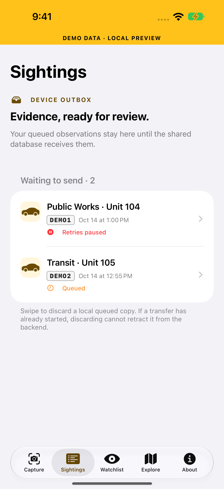
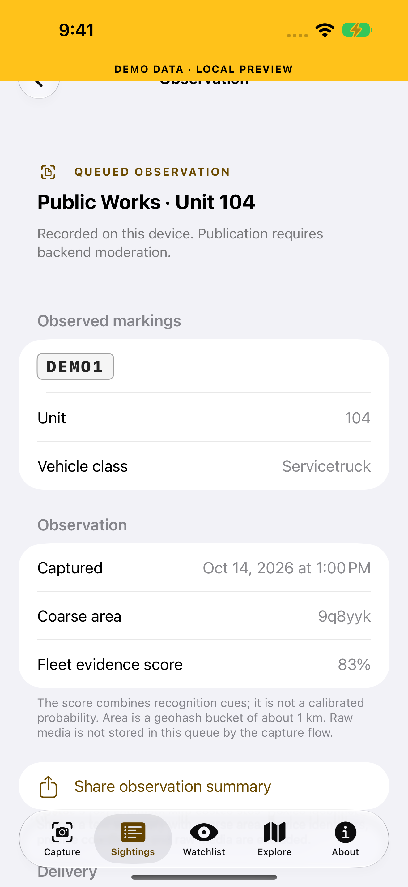
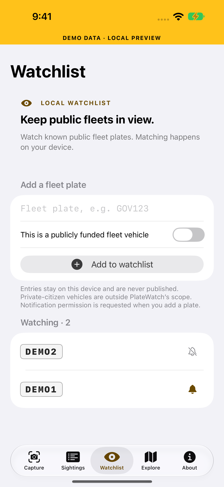

# PlateWatch

**Open accountability infrastructure for publicly funded fleets: on-device vehicle
recognition, a macOS camera Hub, and cited records/FOIA workflows. Pre-alpha;
production publication and field acceptance are still being verified.**
Turning the tables on mass surveillance: a community platform for identifying,
cataloging, and sharing information about taxpayer-funded vehicles — police,
fire, public works, transit, and government fleets — using commodity cameras
and on-device machine learning.

> Built Swift-first for macOS / iOS / watchOS on Xcode 27 (Swift 6.4),
> with a portable REST protocol and reference server so every platform can
> join later. Core ML runs on Apple Neural Engine; no frame ever has to
> leave the device.

---

## Project status — pre-alpha

**Updated October 23, 2026.** The active development branch is
[`feat/hub-moderation`](https://github.com/noktirnal42/PlateWatch/tree/feat/hub-moderation).
It contains work beyond the default branch. The [project audit](docs/PROJECT-AUDIT-2026-10-23.md)
compares the implementation with the specs, identifies stale documentation and
sets acceptance checks for the remaining work.
[Project website and screenshot gallery](https://noktirnal42.github.io/PlateWatch/).

<p>



</p>

These are real simulator UI captures with **synthetic local preview data**, not
recognition, field-camera or backend-publication proof. Sightings is an outbox;
delivery receipts retain local history. Production schema deployment is recorded; credentialed
publication and two-account isolation remain acceptance gates.


The core loop now works on real photos: **point it at (or import a photo of) a public-service
vehicle and it recognises it, reads door text and plates, and records it** — with a human
confirm step for borderline cases. Measured on 62 real US photos
([docs/EVALUATION.md](docs/EVALUATION.md)): **100 % precision, 0 civilian false positives,
57 % automatic recall on Mac / 59 % on iPhone in the initial baseline**
on Apple Vision alone. The evaluation document records later configurations separately. Recall is the weak side and is the main thing still to improve.

| Area | State |
|---|---|
| Core packages | Domain, capture, inference, sync, importers, records, feeds and agent packages implemented; see the audit for current local verification. |
| iOS app | Photo capture/import, review, receipts, watchlists, event-clip export and runtime backend settings; handheld motion/low-light/thermal acceptance remains. |
| Reference server | Ingest, moderation/audit, tombstones, exports, aggregates, agency reports and CloudKit publisher implemented; public hosting and credentialed publication remain. |
| CloudKit | Production schema deployment and signed account diagnostics recorded; schema presence does not prove two-account isolation or public delivery. |
| Models | [models-v0.1.0](https://github.com/noktirnal42/PlateWatch/releases/tag/models-v0.1.0) released, including the project-trained plate detector and optional vehicle models. Plate-state classifier remains experimental and unregistered. |
| macOS Hub | Moving HLS playback with fast tracked overlays, slower fleet analysis and optional bounded body-type estimates; policy-mediated feeds, camera map, favorites/watch/block, intact local evidence, delivery history, moderation, records, FOIA and RSS/Atom intake. Raw RTSP and type-model installation and quality evaluation remain open. [Type-model runtime notes](docs/HUB-LIVE-TYPES-2026-10-23.md). |
| Agents | Authenticated local MCP, bounded Apple/MLX assistants and explicitly selected NVIDIA public research; PCC and broader task-quality evaluation remain open. |
| watchOS / CarPlay | Signed watch install/launch recorded; push delivery remains a physical-device gate. CarPlay requires entitlement and device verification. |
| Beyond Apple | Read-only Android client, reference Python edge agent, web explorer and REST deployment packaging implemented; hosted/device acceptance remains. |

[](https://github.com/noktirnal42/PlateWatch/actions/workflows/ci.yml)

Known problems and what was fixed: [docs/QA-REPORT.md](docs/QA-REPORT.md). Plan:
**M-Alpha** in [docs/ROADMAP.md](docs/ROADMAP.md). Contributions welcome.

## What it does

| Stage | Tech | Runs where |
|---|---|---|
| Vehicle detection | CoreML object detector (YOLO family) | On-device (ANE) |
| Vehicle attributes (make/model/color/type, light bars, decals) | Optional vehicle-type classifier, conservative colour heuristic; make/model and re-ID upgrades need evaluation | On-device |
| Plate detection | CoreML plate detector (converted from open ONNX/YOLO models) | On-device |
| Plate OCR | Apple Vision `VNRecognizeTextRequest`; specialized OCR model remains planned | On-device |
| Fleet/Agency parse (door text → agency, unit number) | Vision text + Apple FoundationModels structured extraction (iOS/macOS 26+) | On-device |
| Enrichment (unit # → agency roster, public records) | Public-records connectors + moderation queue | Backend |
| Shared database | **CloudKit public database (free tier)** | All Apple devices |
| Cross-platform sync | Reference Vapor REST server (AGPL), free-tier-hostable | Any platform |

## Mission rules (non-negotiable, encoded in the data layer)

1. **Government / fleet focus.** The platform exists to track *publicly funded
   assets*. Private-citizen plates are redacted by default on ingest unless a
   fleet-confidence threshold is met. See [docs/LEGAL-ETHICS.md](docs/LEGAL-ETHICS.md).
2. **Public records only.** Officer/agency enrichment comes exclusively from
   public sources (fleet registries, FOIA releases, rosters, auction listings)
   with a stored citation per field. Never DMV data (DPPA).
3. **Evidence quality.** Every sighting is content-hashed (SHA-256) and
   timestamped; sources carry provenance.
4. **On-device first.** Raw video never leaves the device. Only structured,
   human-reviewable detections sync.

## Repository layout

```
apps/            iOS app, macOS "Hub" app, watchOS companion (xcodegen projects)
packages/
  PlateKit/      Domain model + plate normalization/validation (pure Swift)
  CaptureKit/    AVFoundation + Vision capture & analysis pipeline
  VehicleML/     CoreML model registry, detectors, re-ID, OCR engines
  PlateSync/     Sync abstraction + CloudKit backend + REST client + outbox
server/          Optional self-hosted mirror (Vapor + Postgres) for non-Apple platforms
docs/            Research, hardware guide, architecture, data model, legal/ethics, roadmap
models/          Model registry manifest (weights are downloaded, never committed)
scripts/         coremltools conversion pipeline (.venv, never outside workspace)
.github/         CI
```

## Quick start

```bash
# 1. Verify the core packages build and test
swift build --package-path packages/PlateKit && swift test --package-path packages/PlateKit

# 2. (Optional) convert the recommended open models to CoreML
python3 -m venv scripts/.venv && scripts/.venv/bin/pip install -r scripts/requirements.txt
scripts/.venv/bin/python scripts/convert_models.py --all

# 3. Generate the app projects (requires xcodegen)
(cd apps/ios && xcodegen) && (cd apps/macos-hub && xcodegen) && (cd apps/watchos && xcodegen)
open apps/ios/PlateWatch.xcodeproj

# 4. Enable the CloudKit capability (container iCloud.org.platewatch.platewatch),
#    build, run.
```

## Documentation

- [docs/RESEARCH.md](docs/RESEARCH.md) — existing projects to port, CoreML model survey, camera research summary
- [docs/HARDWARE.md](docs/HARDWARE.md) — camera hardware guide (phones → PoE → dedicated ALPR)
- [docs/ARCHITECTURE.md](docs/ARCHITECTURE.md) — system design
- [docs/DATA-MODEL.md](docs/DATA-MODEL.md) — schema (CloudKit record types + SQL mirror)
- [docs/BACKEND.md](docs/BACKEND.md) — CloudKit-first backend, free-tier self-host options
- [docs/LEGAL-ETHICS.md](docs/LEGAL-ETHICS.md) — the guardrails that keep this lawful and safe
- [docs/ROADMAP.md](docs/ROADMAP.md) — milestones and feature backlog
- [docs/QA-REPORT.md](docs/QA-REPORT.md) — latest QA findings, ranked by severity, with resolution status
- [docs/NEXT-STEPS.md](docs/NEXT-STEPS.md) — what is not done yet and how to do it (start here)
- [docs/EVALUATION.md](docs/EVALUATION.md) — real-world accuracy on a licensed photo corpus
- [cloudkit/README.md](cloudkit/README.md) — CloudKit schema and one-time setup
- [docs/DECISIONS.md](docs/DECISIONS.md) — decision log for model and design choices
- [docs/FOIA.md](docs/FOIA.md) — requesting fleet records from agencies
- [docs/PLATE-DESIGN-DATASET.md](docs/PLATE-DESIGN-DATASET.md) — plate-design classifier dataset plan

## License

AGPL-3.0 — see [LICENSE-AGPL-3.0.txt](LICENSE-AGPL-3.0.txt). Contributions
welcome; see [CONTRIBUTING.md](CONTRIBUTING.md).

### Agent access

The macOS Hub includes a local authenticated command bridge and a 14-tool stdio MCP adapter for Codex, Claude Code/Desktop and OpenCode. The installer preserves other client settings and installs a portable PlateWatch skill. Agents can inspect feeds/records/queued evidence, set stars and blocks, navigate Live, draft fleet FOIA text and import cited CSVs as pending candidates. Terms approval and moderation remain human operations. [Setup, verification and the planned on-device/PCC/MLX internal-agent architecture](docs/AGENT-INTEGRATION.md).
