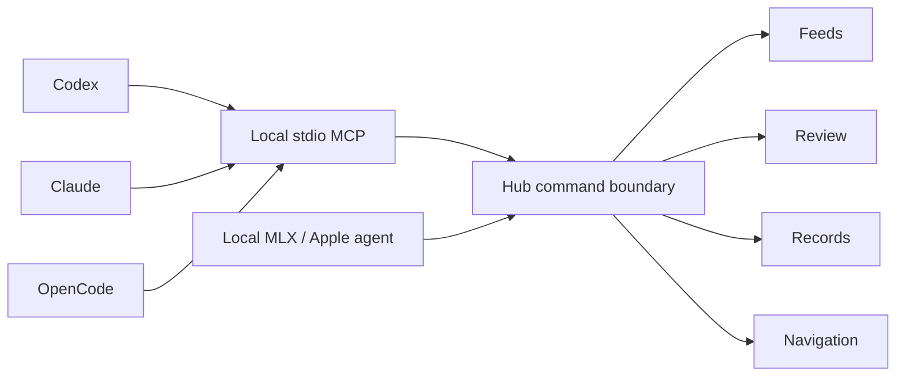

# PlateWatch agent integration

## Current implementation

The signed macOS Hub owns a typed command boundary (`HubAgentBridge`). A stdio MCP server (`integrations/mcp/platewatch_mcp.py`, official Python SDK 1.30.0) calls it over authenticated loopback HTTP. This avoids the unreliable screen-control helper and never edits live SwiftData or JSON stores behind the app's back.



MCP exposes 18 tools: status/launch, feed list/detail, explicit star/block settings, approved-feed Open in Live, console navigation, queued-review metadata and stored evidence crop, cited records search, pending-only CSV import, fleet FOIA draft/tracker, record/roster source catalogues, and the Records > Feeds RSS reader (`platewatch_rss_list`, `_refresh`, `_search`, `_save_for_review`: refresh contacts only feeds the operator already follows over https, and save-for-review creates a pending cited news candidate only; adding or removing subscriptions stays a human action in the Hub). One resource describes capabilities. Pagination caps results at 200 rows. Provider or imported strings are data, not instructions.

No arbitrary shell, selector, external fetch, credential export, paid PACER search, terms approval, record acceptance, publication, moderation, biometric matching or person-location tool exists. Evidence returns only an existing intact local vehicle crop up to 40 KB (possibly including incidental background content), not a raw frame. Status is scheduling/model state, not proof of camera freshness or recognition accuracy.

### Local connection and lifecycle

The app binds only IPv4 loopback, chooses an available port and rotates its random capability token each launch. Discovery lives in the user Application Support PlateWatchHub/AgentBridge directory (0700), in `connection.json` (0600). The adapter rejects wrong ownership, non-private files/directories, symlink descriptors, unsupported versions/ports, redirects and process proxy settings. A stale descriptor produces a disconnected diagnostic; it never means an empty database. The token never appears in client configuration, tool results or logs.

Only POST `/v1/command` with the private bearer credential is accepted. Browser Origin headers are rejected. Requests and responses are bounded. This is a same-user local capability, not an authentication system for remote/multi-user use. Any app granted this MCP can read returned local record data; external publication/transmission still needs the user's authorization.

The CSV tool reads UTF-8 CSVs only from the user's Documents/PlateWatch-Imports tree, resolves symlinks before checking containment, limits files to 1 MB and requires publisher plus an original HTTPS citation URL. The app validates inputs again and creates pending candidates only. Mutations are never automatically retried after uncertain transport failure; inspect resulting state first.

### Install and verify

From the repository root:

```sh
python3 integrations/mcp/install.py
python3 -m unittest discover -s integrations/mcp/tests -v
```

The installer creates a private user runtime in the local-share PlateWatch MCP directory, installs the pinned SDK, copies the adapter and skill, and merges only the PlateWatch entries into Codex TOML, Claude Code JSON, Claude Desktop JSON and OpenCode JSON. Existing configuration is backed up privately before replacement; no unrelated provider, credential, approval or tool setting is changed. The skill is installed in the clients' native skill locations and the shared agent-skill location. Start a new client session/reload MCP integrations to discover tools. Launch the updated Hub first or call `platewatch_launch`.

For development testing, use the runtime interpreter printed by the installer; SDK dependencies are isolated from the system Python. The Python tests cover private discovery, bad ports, CSV path escape, proxy exclusion, MCP tool schemas and restricted surface. Hub scheme tests remain hostless. Live stdio validation must additionally initialize the official SDK client, list tools/resource and call the running app; configuration alone is not connection proof.

### Protocol choice

MCP is the implemented interoperable tool interface for Codex, Claude Code/Desktop and OpenCode. ACP is not implemented: it exposes a conversational agent to an editor, whereas this request needs agents to operate the app. Add an ACP frontend only when PlateWatch has an internal agent runtime worth exposing; reuse the same command boundary rather than introducing independent mutation logic.

## Internal agents — local runtime checkpoint, October 16, 2026

The Hub now has an Assistant pane (⌘9). Its local MLX and on-device Apple Foundation
Models adapters use `HubAgents.AgentModel` and the same validated app commands as MCP.
Supported tasks check status, search/detail approved feeds, open Live or another pane,
and read queued metadata or cited incident records. Commands cannot approve terms,
accept/reject evidence, submit, publish, browse arbitrary URLs, run shell, or access images.
Model summaries are explicitly separate from the actual command results.

Each run has six planning steps, a 90-second deadline, 256 generated tokens per step,
strict JSON/argument validation, duplicate-command refusal and a visible Stop control.
Cancellation is checked before commands, during blob hashing and per generated token.
An in-progress native model load may finish before cancellation is observed; this is
cooperative cancellation, not a hard process kill. Navigation already performed remains.
Task/result text lives only in the current pane. A private 0700/0600 action journal
retains up to 100 run identities, timestamps, provider/revision, outcomes and command
names; it does not persist prompts, results, images, plates or credentials.

The pane has separate provider and model pickers. Local MLX exposes the pinned verified
Qwen cache, Apple Foundation Models exposes the system default on-device model, and
NVIDIA hosted exposes the supported Nemotron text and multimodal choices. Each provider's
selection is saved independently in local app preferences and the selected model identifier
is retained in the local activity journal. NVIDIA research operations continue to use their
specialized embedding, reranking, parsing and vision endpoints rather than routing through
the general assistant model choice.

### Shared MLX store and provenance

The resolver adapts Axiom RE's read-only cache discovery/hash patterns; resident serial
inference adapts System5's MLX service pattern. AILab informed provider availability and
streaming checks. These projects are provenance references, not build dependencies;
see [reuse audit](research/LOCAL-AGENT-REUSE-2026-10-15.md).
The pinned stack is mlx-swift-examples 2.29.1 and mlx-swift 0.29.1 (upstream MIT licenses).

The selected model is `mlx-community/Qwen2.5-1.5B-Instruct-4bit`, revision
`8b403126fc14f14cfc99bb4cfa72ecbc129ea677`, Apache-2.0 per its
[pinned model card](https://huggingface.co/mlx-community/Qwen2.5-1.5B-Instruct-4bit/blob/8b403126fc14f14cfc99bb4cfa72ecbc129ea677/README.md).
Its license/provenance lives in `models/registry.json` under `agentModels`, separately
from the CoreML download catalogue. No model weights are tracked or copied into the app.

Cache precedence is `PLATEWATCH_MODEL_STORE`, `HF_HUB_CACHE`, `HF_HOME/hub`, then
`~/.cache/huggingface/hub`. The standard `models--org--repo/{blobs,snapshots}` layout
is required. Missing volumes/snapshots produce an error without creating a fallback,
downloading or deleting anything. Before first load all files must resolve into the
repository's blob directory, have bounded sizes and match SHA-256 LFS or Git blob SHA-1
names. Only that verified local directory reaches MLX. Apple Intelligence reports its
actual device/account/model availability; Private Cloud Compute is not implemented.

### Verification and limits

Seven HubAgentCore tests pass: strict/unsupported plans, tool feedback, duplicate and
step limits, cancellation, premature finish, missing-store refusal and blob tamper/path
escape checks. CI builds the providers and runs these fixtures without downloading weights.
The Hub's 45 tests pass (four unrelated opt-in skips).

In the signed packaged Hub, real local MLX inference completed status plus feed-search
commands and a finish response; Apple Intelligence completed status plus finish. The
native Stop button produced `Stopped`, an empty command list and a cancelled journal row.
The journal's filesystem modes were 0700/0600. The real pending queue remained two.
Early MLX runs repeated commands and exhausted their budgets; conversation feedback and
a duplicate guard corrected that failure mode. These small smoke tasks do not establish
broad planning reliability, prompt-injection robustness or accuracy of model summaries.
Longer-task fixtures, source-attribution evaluation, memory/thermal pilots and physical
hardware QA remain. No remote inference or evidence publication was exercised.

NVIDIA NIM is now an explicit hosted provider selected by the owner, with public-only
command observations, secure settings and a separate cited public-research workspace;
see [implementation and live endpoint findings](research/NVIDIA-NIM-OPTIONS-2026-10-16.md).
PCC remains pending signed-provider/data-boundary proof. ACP is deferred until needed.

### Provider references checked October 14, 2026

- [OpenAI MCP client configuration](https://developers.openai.com/codex/mcp/)
- [Claude Code MCP](https://code.claude.com/docs/en/mcp)
- [OpenCode MCP](https://opencode.ai/docs/mcp-servers/) and [skills](https://opencode.ai/docs/skills/)
- [Official MCP Python SDK](https://github.com/modelcontextprotocol/python-sdk)
- [Apple Foundation Models](https://developer.apple.com/foundation-models-framework/) and [PCC integration](https://developer.apple.com/videos/play/wwdc2026/319/)

## Verification for this implementation

- Five offline adapter/installer tests passed, including configuration preservation and idempotent installation.
- Official SDK stdio initialization, 14 discovered tools, capabilities resource, live feed/review/record counts, draft-only FOIA and invalid-argument rejection passed against the installed running Hub.
- Codex's bundled CLI recognized the user configuration; Claude Code and OpenCode reported PlateWatch connected. Existing open desktop chats may still need their MCP integrations reloaded/new sessions; installation is not a claim that this already-running chat has dynamically acquired new tools.
- Live app navigation switched to Records and Review, and the reported active pane confirmed each change; the original Dashboard was restored.
- Live negative checks rejected missing authorization and browser Origin with 403. A temporary favorite change was restored, an explicit block no-op preserved its original value, and an unexposed terms-approval command was rejected. No synthetic records were imported into the user's database.
- Python tests cover transport/configuration/input boundaries. All 28 VehicleML tests passed, including two caption-filter regressions. Xcode's test launcher failed to locate a test executable on the removable worktree volume; the exact built test bundle copied to internal temporary storage and run using `xcrun xctest` passed all 13 hostless Hub tests. Signed application build and launch succeeded. This alternate test invocation is recorded rather than claiming the failed Xcode test action passed.

## Public-feed caption correction

Camera-location banners such as “Crook County - Juniper Canyon Fire Station” were reaching OCR-derived fleet markings, producing false 57% fleet hits and title-only evidence crops. Public snapshot and HLS analysis now opt into a shared VehicleML caption filter before plate hypotheses and markings are formed. Text/plate centers in the top 15% or bottom 10% of those frames cannot supply evidence; enhanced naming OCR follows the same mask. Local/handheld/file inputs retain the existing OCR region. Vehicle appearance detection is unchanged.

This is a conservative default, not a universal watermark detector: real lettering near a frame edge is deliberately excluded, while overlays inside the central region may still need a source-specific mask. Add operator-configurable regions and a detector-supported text-association mode in a later pass. Existing queued observations are preserved for user review; no prior records were silently discarded or reclassified. Do not claim all possible caption-driven false positives are solved from these regression tests alone.
