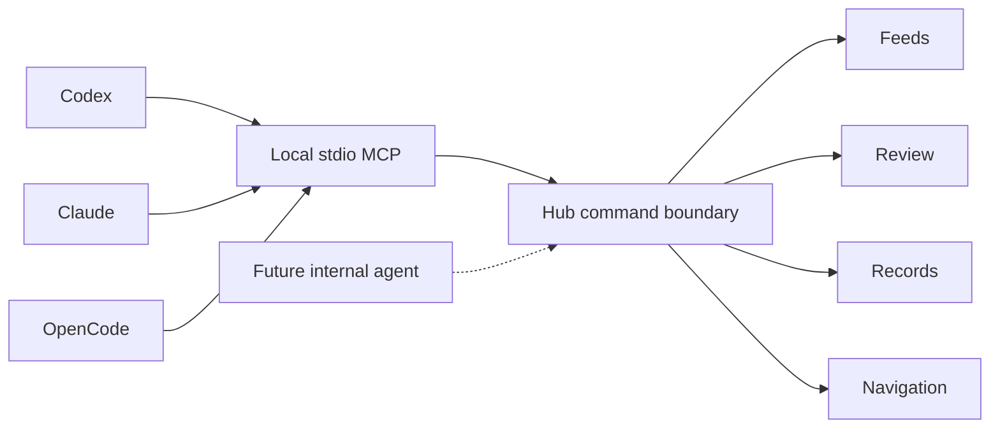

# PlateWatch agent integration

## Current implementation

The signed macOS Hub owns a typed command boundary (`HubAgentBridge`). A stdio MCP server (`integrations/mcp/platewatch_mcp.py`, official Python SDK 1.30.0) calls it over authenticated loopback HTTP. This avoids the unreliable screen-control helper and never edits live SwiftData or JSON stores behind the app's back.



MCP exposes 14 tools: status/launch, feed list/detail, explicit star/block settings, approved-feed Open in Live, console navigation, queued-review metadata and stored evidence crop, cited records search, pending-only CSV import, fleet FOIA draft/tracker, and record/roster source catalogues. One resource describes capabilities. Pagination caps results at 200 rows. Provider or imported strings are data, not instructions.

No arbitrary shell, selector, external fetch, credential export, paid PACER search, terms approval, record acceptance, publication, moderation, biometric matching or person-location tool exists. Evidence returns only an existing intact local vehicle crop up to 40 KB (possibly including incidental background content), not a raw frame. Status is scheduling/model state, not proof of camera freshness or recognition accuracy.

### Local connection and lifecycle

The app binds only IPv4 loopback, chooses an available port and rotates its random capability token each launch. Discovery lives in the user Application Support PlateWatchHub/AgentBridge directory (0700), in `connection.json` (0600). The adapter rejects wrong ownership, non-private files/directories, symlink descriptors, unsupported versions/ports, redirects and process proxy settings. A stale descriptor produces a disconnected diagnostic; it never means an empty database. The token never appears in client configuration, tool results or logs.

Only POST `/v1/command` with the private bearer credential is accepted. Browser Origin headers are rejected. Requests and responses are bounded. This is a same-user local capability, not an authentication system for remote/multi-user use. Any app granted this MCP can read returned local record data; external publication/transmission still needs the user's authorization.

The CSV tool reads UTF-8 CSVs only from the user's Documents/PlateWatch-Imports tree, resolves symlinks before checking containment, limits files to 1 MB and requires publisher plus an original HTTPS citation URL. The app validates inputs again and creates pending candidates only. Mutations are never automatically retried after uncertain transport failure; inspect resulting state first.

### Install and verify

From the repository root:

```sh
python3 integrations/mcp/install.py
python3 -m unittest discover -s integrations/mcp/tests -v
```

The installer creates a private user runtime in the local-share PlateWatch MCP directory, installs the pinned SDK, copies the adapter and skill, and merges only the PlateWatch entries into Codex TOML, Claude Code JSON, Claude Desktop JSON and OpenCode JSON. Existing configuration is backed up privately before replacement; no unrelated provider, credential, approval or tool setting is changed. The skill is installed in the clients' native skill locations and the shared agent-skill location. Start a new client session/reload MCP integrations to discover tools. Launch the updated Hub first or call `platewatch_launch`.

For development testing, use the runtime interpreter printed by the installer; SDK dependencies are isolated from the system Python. The Python tests cover private discovery, bad ports, CSV path escape, proxy exclusion, MCP tool schemas and restricted surface. Hub scheme tests remain hostless. Live stdio validation must additionally initialize the official SDK client, list tools/resource and call the running app; configuration alone is not connection proof.

### Protocol choice

MCP is the implemented interoperable tool interface for Codex, Claude Code/Desktop and OpenCode. ACP is not implemented: it exposes a conversational agent to an editor, whereas this request needs agents to operate the app. Add an ACP frontend only when PlateWatch has an internal agent runtime worth exposing; reuse the same command boundary rather than introducing independent mutation logic.

## Internal agents — planned, not implemented

Owner direction: PlateWatch should eventually contain agents that can drive its own app. Three inference providers are planned:

1. **Apple Foundation Models on device.** Reuse availability checks, guided generation and tool calling. The existing FoundationModelsParser is a markings parser, not an internal agent runtime.
2. **Apple Foundation Models over Private Cloud Compute.** Apple's current framework documents server-model access, subject to platform support, provisioning/entitlement, account approval and availability. An actual request from the signed PlateWatch bundle is the acceptance gate. A claimed-ready model or entitlement preflight alone does not prove inference. No raw frames, plates, precise locations, private records or credentials should be routed to a remote model by default; retain the project's on-device-first boundary and explicit payload policy.
3. **Local MLX models from Hugging Face.** Reuse the universal store established in Axiom RE, not a new per-app weight cache. The store is the standard Hugging Face `models--org--repo/{blobs,refs,snapshots}` layout. Honor `HF_HUB_CACHE`, then `HF_HOME/hub`, then the standard home cache, with an optional PlateWatch override. On this machine the existing home cache resolves to the removable drive; do not hardcode that volume or commit links to it. Preserve pinned revisions, licenses, hash verification, resumable downloads and deduplication. If a configured/symlinked volume is absent, report it and stop; never silently create a replacement weight store on the boot disk. See Axiom RE's `docs/UNIVERSAL_MODEL_STORE.md` and `Sources/AxiomCore/Intelligence/ModelStore.swift` before extracting a reusable component.

Build sequence:

- Define a model-provider protocol and capability/availability result independently from app commands. Never turn model-generated strings into arbitrary command names or selectors.
- Add a local planner/executor using the same validated commands, with tool allowlists, request IDs, bounded steps/time/tokens, cancellation, task history and visible progress. Separate read-only plans from mutations; preserve the user's chosen authorization policy.
- Persist a local action journal with redacted arguments, outcome, provider/model/revision and citations. Do not log credentials, raw images or private plate data. Add an agent activity pane and stop control.
- Add Foundation Models on-device and MLX adapters first, then PCC only after its signed-provider/data-boundary checks pass. Do not download or delete shared models without an explicit model-management action.
- Evaluate tool selection, unsupported-command rejection, prompt injection in source excerpts, offline/missing-volume behavior, cancellation, false-positive handling and source attribution against fixed fixtures. Runtime task completion requires observable app-state evidence.
- Keep terms confirmation, record acceptance and moderation outside autonomous workflows until a separately reviewed design supports the intended human review. No face identification, person sightings map, presence alerts or name-only automatic identity confirmation.

### Provider references checked October 14, 2026

- [OpenAI MCP client configuration](https://developers.openai.com/codex/mcp/)
- [Claude Code MCP](https://code.claude.com/docs/en/mcp)
- [OpenCode MCP](https://opencode.ai/docs/mcp-servers/) and [skills](https://opencode.ai/docs/skills/)
- [Official MCP Python SDK](https://github.com/modelcontextprotocol/python-sdk)
- [Apple Foundation Models](https://developer.apple.com/foundation-models-framework/) and [PCC integration](https://developer.apple.com/videos/play/wwdc2026/319/)

## Verification for this implementation

- Five offline adapter/installer tests passed, including configuration preservation and idempotent installation.
- Official SDK stdio initialization, 14 discovered tools, capabilities resource, live feed/review/record counts, draft-only FOIA and invalid-argument rejection passed against the installed running Hub.
- Codex's bundled CLI recognized the user configuration; Claude Code and OpenCode reported PlateWatch connected. Existing open desktop chats may still need their MCP integrations reloaded/new sessions; installation is not a claim that this already-running chat has dynamically acquired new tools.
- Live app navigation switched to Records and Review, and the reported active pane confirmed each change; the original Dashboard was restored.
- Live negative checks rejected missing authorization and browser Origin with 403. A temporary favorite change was restored, an explicit block no-op preserved its original value, and an unexposed terms-approval command was rejected. No synthetic records were imported into the user's database.
- Python tests cover transport/configuration/input boundaries. All 28 VehicleML tests passed, including two caption-filter regressions. Xcode's test launcher failed to locate a test executable on the removable worktree volume; the exact built test bundle copied to internal temporary storage and run using `xcrun xctest` passed all 13 hostless Hub tests. Signed application build and launch succeeded. This alternate test invocation is recorded rather than claiming the failed Xcode test action passed.

## Public-feed caption correction

Camera-location banners such as “Crook County - Juniper Canyon Fire Station” were reaching OCR-derived fleet markings, producing false 57% fleet hits and title-only evidence crops. Public snapshot and HLS analysis now opt into a shared VehicleML caption filter before plate hypotheses and markings are formed. Text/plate centers in the top 15% or bottom 10% of those frames cannot supply evidence; enhanced naming OCR follows the same mask. Local/handheld/file inputs retain the existing OCR region. Vehicle appearance detection is unchanged.

This is a conservative default, not a universal watermark detector: real lettering near a frame edge is deliberately excluded, while overlays inside the central region may still need a source-specific mask. Add operator-configurable regions and a detector-supported text-association mode in a later pass. Existing queued observations are preserved for user review; no prior records were silently discarded or reclassified. Do not claim all possible caption-driven false positives are solved from these regression tests alone.
